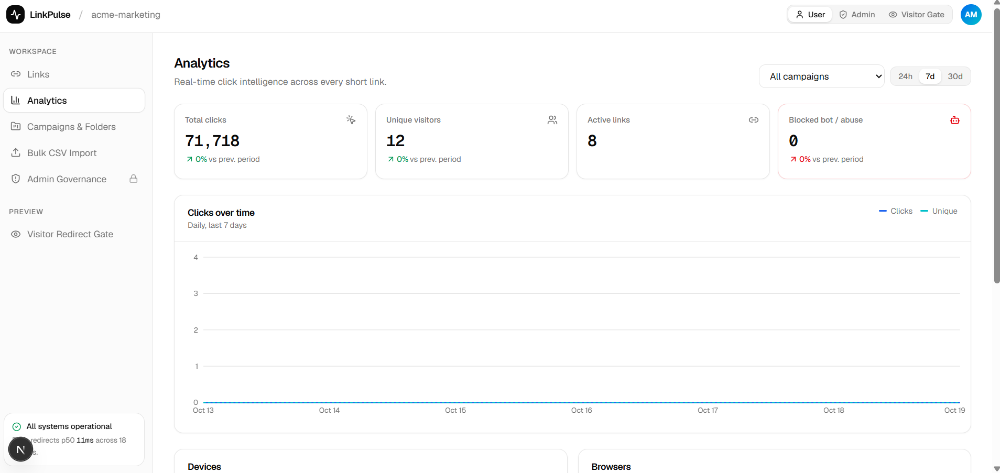
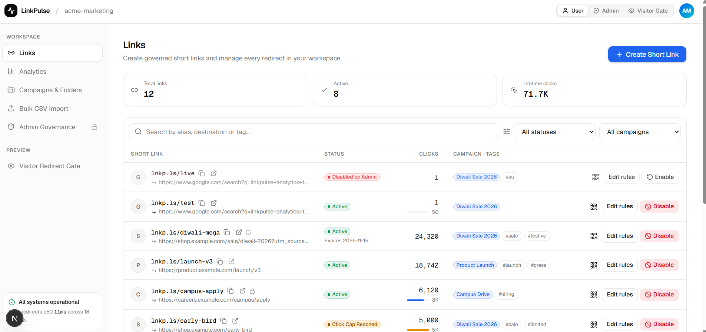
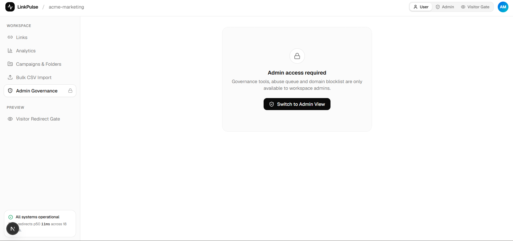
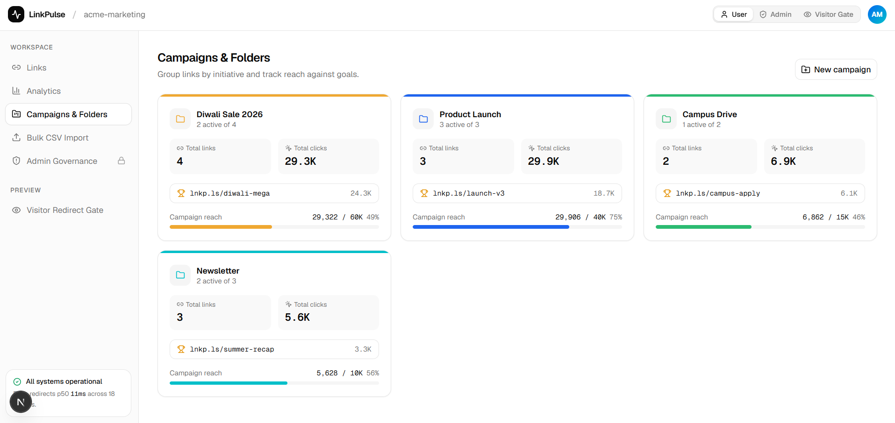
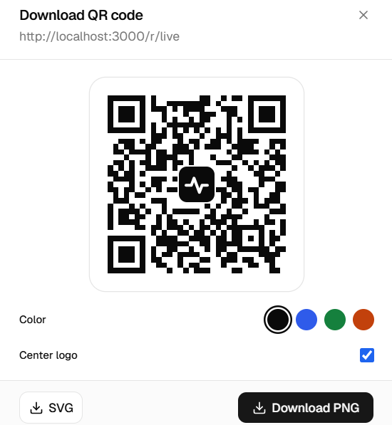

# LinkPulse — Smart URL Shortener & Analytics Platform

**Create smarter links. Track engagement. Manage links with confidence.**

LinkPulse is a web-based URL shortening and link-management platform that helps users create short links, customize aliases, organize campaigns, monitor engagement, and manage link restrictions through a centralized dashboard.

🔗 **Live Demo:** https://linkpulsee.netlify.app      
💻 **GitHub Repository:** https://github.com/sonigariya/linkpulse

---

## 📌 Problem Statement

Long URLs are difficult to share, manage, and track. Basic URL-shortening tools may not provide all the features users need to organize campaigns, understand audience engagement, control link access, and identify potentially suspicious destinations.

Users need a centralized solution that makes links easier to share while providing useful analytics and configurable link-management capabilities.

## 💡 Our Solution

LinkPulse brings URL shortening, link management, analytics, campaign organization, and basic URL safety checks into a single dashboard.

Users can create short links, configure custom aliases, organize links using campaigns and tags, set access restrictions, generate QR codes, and review engagement statistics.

The platform also provides administrative tools for reviewing suspicious-link reports and managing blocked domains.

Our goal is to make link sharing more manageable, measurable, and security-conscious.

## ✨ Key Features

### 1. Smart URL Shortening

* Convert long URLs into short, shareable links.
* Generate short aliases and configure custom aliases.
* Validate destination URLs.
* Copy generated links for easy sharing.

### 2. Link Management

* View and manage created links from a centralized dashboard.
* Organize links using campaigns and tags.
* Search and filter links.
* Configure link rules and manage link status.

### 3. Link Access Controls

* Configure link expiration dates.
* Set maximum click limits.
* Support password-protected links.
* Configure different destinations for mobile and desktop visitors.

### 4. Analytics Dashboard

* View click statistics and link performance.
* Explore device and browser information.
* Review referral-source data.
* Analyze campaign performance.
* View click activity and related engagement metrics.

*Note: Initial sample analytics may be displayed for demonstration. Actual analytics should be distinguished from sample data.*

### 5. QR Code Generation

* Generate QR codes for short links.
* Make links easier to share through posters, presentations, and offline campaigns.

### 6. Campaign and Tag Management

* Organize links into campaigns.
* Add descriptive tags.
* Filter links by campaign.
* Manage links for different marketing or sharing purposes.

### 7. Bulk CSV Import

* Import multiple links from CSV files.
* Validate imported destination URLs.
* Organize imported links using available campaign and tag fields.

### 8. URL Safety Checks

* Validate URL formats and supported protocols.
* Check configured blocked domains.
* Identify selected suspicious URL patterns.
* Display warnings for potentially unsafe destinations.

These checks provide basic protection but cannot guarantee that every destination is safe.

### 9. Admin Governance

* Review suspicious-link reports.
* Manage the configured domain blocklist.
* Review reported destinations.
* Disable links when required.

Administrative features should be backed by proper server-side authentication and authorization before production use.

---

## 🛠️ Technology Stack

| Technology   | Purpose                                  |
| ------------ | ---------------------------------------- |
| Next.js      | Web application framework and API routes |
| React        | Interactive user interface               |
| TypeScript   | Type-safe development                    |
| Tailwind CSS | Styling and responsive layouts           |
| Recharts     | Analytics charts and visualizations      |
| Lucide React | Icons                                    |
| QRCode React | QR-code generation                       |
| Base UI      | UI interaction components                |
| Node.js      | JavaScript runtime                       |
| pnpm         | Package management                       |
| Netlify      | Deployment and hosting                   |

---

## ⚙️ Getting Started

### Prerequisites

Install the following tools:

* Node.js
* pnpm
* Git

### 1. Clone the repository

```bash
git clone https://github.com/sonigariya/linkpulse.git
```

### 2. Navigate to the project directory

```bash
cd linkpulse
```

### 3. Install dependencies

```bash
pnpm install
```

### 4. Start the development server

```bash
pnpm dev
```

### 5. Open the application

Visit the following address in your browser:

```text
http://localhost:3000
```

### 6. Build for production

```bash
pnpm build
```

To run the production build locally:

```bash
pnpm start
```

If the project requires environment variables, configure them according to the project's actual configuration before running or deploying the application.

---

## 🏗️ How It Works

1. The user enters a destination URL.
2. The user configures an alias and available link settings.
3. The application validates the destination and processes the request.
4. A short link is created and displayed.
5. The user shares the short link or its QR code.
6. Visitors open the short link and are redirected according to the configured rules.
7. Click activity can be reviewed through the analytics dashboard.
8. Administrative tools support the review and management of reported links.

The availability of each step depends on the relevant feature being correctly configured and operational in the deployed application.

---

## 🖼️ Screenshots

Screenshots of the actual application will be added here to demonstrate its interface and functionality.


### analytics



### Link Management



### Admin Governance



### campaingns



### qr 



---

## 🌐 Deployment

LinkPulse is deployed on Netlify.

**Live Application:** https://linkpulsee.netlify.app

The production deployment is connected to the GitHub repository. When automatic publishing is enabled, changes pushed to the configured production branch can trigger a new deployment.

The live application should be tested after every significant update to verify that its interface, API routes, redirects, and data operations work correctly.

---

## 🔐 Security Considerations

LinkPulse includes basic URL validation, configurable link restrictions, suspicious-pattern checks, and administrative link-management features.

Important security considerations include:

* Validate URLs on the server as well as in the browser.
* Keep API keys and credentials out of source control.
* Use secure password handling for protected links.
* Enforce administrative permissions on the server.
* Use persistent storage suitable for the deployment environment.
* Avoid treating rule-based URL checks as a guarantee of safety.

---

## 🚧 Current Limitations

* Initial analytics may include sample data.
* Rule-based URL validation cannot detect every malicious destination.
* Persistent data storage must be verified in the deployed environment.
* Authentication and administrative authorization must be verified before production use.
* Actual feature availability should be confirmed through application testing.

---

## 🔮 Future Enhancements

* Integration with a persistent database.
* Stronger phishing and malicious-domain detection.
* Secure authentication and role-based access control.
* More detailed analytics and downloadable reports.
* Improved abuse prevention and rate limiting.
* Enhanced campaign reporting and collaboration.

---

## 🎯 Project Objective

LinkPulse aims to go beyond basic URL shortening by combining link management, analytics, access controls, campaign organization, and basic URL safety checks in one platform.

The project demonstrates how these capabilities can be brought together to provide a more organized and informative link-management experience.

---

## 👥 Team

**Project Name:** LinkPulse

**GitHub Repository:** https://github.com/sonigariya/linkpulse

**Team Members:**
soni gariya 
neha nayal
srishti chaturvedi
tanisha bhatt
khushi gariya

---

## 📄 License

No license has been specified in this README. 

---

*Built for a hackathon focused on practical web development, link management, analytics, and governance.*
